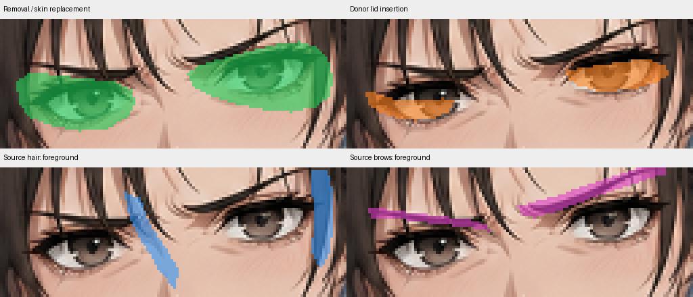

# Practical editing techniques

Read [README.md](README.md) for the workflow. This file explains **how to perform a clean expression, blink or mouth transplant**, and what to try when it goes wrong. The linked scripts contain real code and examples; coordinates and masks from existing characters are **examples, not templates**.

## Choose the least destructive method

| Situation | Do this |
|---|---|
| New static expression; donor face aligns as a whole | **Registered broad face patch**, including eyes/brows/mouth/shading, with joins on matching skin |
| Blink or talking donor aligns to an existing finished expression | **Local eye or mouth replacement**, keeping everything else |
| Broad face patch crosses incompatible hair/jaw/skin | **Separate aligned feature regions** and repair old features first |
| Donor is tilted/shifted/scaled but anatomy matches | Align using corresponding landmarks before masking |
| Donor's needed features have incompatible anatomy or linework | Regenerate a better donor; masking won't fix bad anatomy |

**Never use a narrower mask to conceal a displaced feature.** Fix alignment, repair the source, or choose another donor.

## Expression transplant

A donor is **source material, not a replacement canvas**.

1. **Select:** use the best donor that expresses the intended emotion, matches the source head angle and has clean linework in the region to be copied.
2. **Register:** mark the *same named landmarks* independently on the master and donor (nose/eye corners/chin, as visible). Fit translation, then optional uniform scale/rotation. Check a half-opacity overlay: stable contours should line up. Don't force expression-dependent eyelids or smile width to match Neutral.
3. **Plan the boundary:** prefer one coherent region for a static expression. Place its boundary on compatible skin; avoid copying donor jaw/hair unless those parts are intentionally changed. Include all required emotion shading.
4. **Remove old expression pixels:** the source eye/brow/mouth and their antialiasing cannot remain visible under the donor. The area that must be removed may be **larger than** the new inserted feature.
5. **Insert donor pixels:** use the *aligned* donor and a separately traced insertion region. Include complete new contours and supporting skin/shading. Keep an opaque replacement across old strokes; feather only a small boundary on compatible skin.
6. **Preserve foreground:** restore the master's overlapping hair/ornaments only where they really belong on top. For a *static expression*, do **not** restore old neutral brows or lashes that the expression must replace.
7. **Check all joins:** look at full face and enlarged eyes/brows/mouth, temples, hair strands, jaw/chin and skin gradient. A smooth donor line becoming clipped in the final means the composite is wrong.

**Why old static transplants worked:** the original [expression compositor](static/vn_expression_transplant.py) used a registered, coordinated donor sheet and a broad facial blend. See [`workflow_examples.py`](experiments/workflow_examples.py) for a reproducible example and [`static_alignment.png`](docs/artwork_examples/static_alignment.png) for the resulting stages.

## Blink and mouth: three different selections

1. **Removal (master coordinates):** cover the **entire obsolete feature** (including its antialiased edges, lashes, mouth line and shadows that must disappear).
2. **Insertion (donor coordinates, then aligned):** cover the **complete new feature** and required clean neighbouring skin; exclude unrelated donor hair, brows, face or background.
3. **Foreground (master coordinates):** cover **only intended source hair/brows/ornaments** that should appear above the new feature. Include antialiased strand edges. Do not restore an obsolete lash or old mouth.

These are **not the same mask**. Source foreground gets restored **last**, after removing old pixels and adding the donor.

The working operation order is:

**Align donor → replace/repair old-feature area → insert new contour → repair any join → restore intended source foreground.**

For blink, keep the existing expression's brows and mouth; replace both eyes. For speech, keep eyes/brows; replace only the mouth. Build combined from the already-finished expression, not from Neutral.

- Prefer clean **aligned donor skin** to replace the whole obsolete eye or mouth when it matches; it often already includes the desired new contour.
- If necessary, use a nearby source-skin patch for a small gap, or narrowly bounded inpainting. Inspect the repair **before** inserting the feature.
- Do not reconstruct a whole eye from one flat sampled skin colour; it produces smears and artificial patches.
- Colour-correct **skin only** using corresponding clean skin samples; do not recolour hair/eyelashes/linework.
- Feather skin joins slightly; **never blur across old lines** to hide them. Full coverage removes old strokes.
- Where hair crosses the eye, trace and restore the **whole intended strand**, not just pixels below a generic darkness threshold.

See the [working Angry eye-compositor](experiments/14_angry_animation/angry_visual_blink.py) and the [layered before/after stages](docs/artwork_examples/layered_eye.png). This is a **method reference**, not a reusable pose-specific polygon.

## Diagnose by visible symptom

| Visible defect | Likely cause | Correct fix |
|---|---|---|
| Old eye/iris/mouth still shows | Incomplete old-feature removal | Expand removal and provide clean replacement pixels |
| Eye/lid/mouth appears shifted | Donor was never correctly registered | Correct alignment from landmarks; don't tweak blend radius |
| Double lash/brow or hair wedge | Donor content leaked in, or obsolete source line restored | Trace insertion/foreground separately; exclude wrong pixels |
| Cut eyelash or broken hair strand | Insertion/foreground selection clips the line | Restore complete contour and antialiasing; repair a short endpoint if needed |
| Grey fringe, blur, ghost contours | Old and new strokes blended with partial coverage | Full replacement on strokes; feather only skin boundary |
| Visible rectangular/skin patch | Repair samples or local colour are wrong | Use aligned matching skin and move boundary to safe skin |
| Good PNGs, bad GIFs | Preview palette/matte or frame mapping | Decode and inspect GIF frames; rebuild previews |
| Face looks stitched together | Donor anatomy/head angle too different | Switch to a coherent patch, region-specific alignment, or regenerate |

For failures, compare **source → aligned donor → removal/repair → insertion → foreground → final** at the same coordinates. Identify the **first bad stage**. If two attempts on one problem fail, change the underlying assumption or donor rather than endlessly tuning masks.

## Small technical rules

- Use native image coordinates (`x` right, `y` down). Pillow crop: `(x0, y0, x1, y1)`; NumPy indexing: `[y, x]`; OpenCV target size: `(width, height)`.
- Pillow arrays are RGB/RGBA; OpenCV `imread` uses BGR/BGRA. Convert before mixing channels.
- Composite masks in [`artwork_tools.py`](experiments/artwork_tools.py) are **float 0–1**, not 0–255. Convert PNG masks before use. Cast `uint8` to float/signed integers before subtraction.
- `align_feature` moves **donor and insertion coverage**; do **not** transform master removal/foreground masks. `composite` preserves the master's alpha.
- Before compositing, inspect the **actual aligned overlay**, not just landmark-fit error or equal canvas sizes.
- Use nearest-neighbour **only for diagnostic zoom**; use suitable interpolation when genuinely transforming donor pixels. Avoid repeated resizes.
- Do not trust a clean diff mask or successful script as proof the image looks good.

Relevant APIs: [`artwork_tools.py`](experiments/artwork_tools.py) (`align_feature`, `composite`, `match_skin`, `compose_feature`, `save_stage_review`), [`workflow_examples.py`](experiments/workflow_examples.py), and [`animation_builder.py`](experiments/animation_builder.py). To inspect runnable examples on demand: `python experiments/workflow_examples.py`.

Keep the best working image while experimenting. Stop when the actual result is clean; additional diagnostic rituals cannot improve already-correct pixels.
