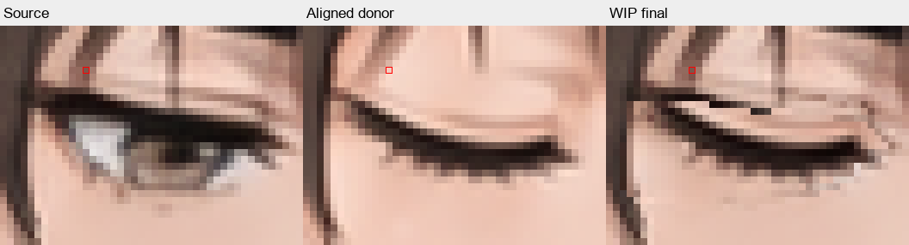

# Artwork transplantation and repair

Use this with the [production workflow](README.md). Diagnose the actual pixels before selecting an operation. Work on one eye or mouth until its correction is demonstrated, then extend the method.

## Separate the selections

| Selection | Coordinates | Includes |
|---|---|---|
| Source removal | Fixed master/source coordinates | Complete old feature, unwanted shadows, and antialiased remnants that must disappear. |
| Donor insertion | Aligned donor coordinates | Desired new feature plus the supporting skin it needs. |
| Source foreground | Fixed master/source coordinates | Identified hair/brows crossing the edit; excludes old eye or mouth linework. |
| Additional cleanup | Explicit target coordinates | Bounded skin reconstruction, seam correction, or line repair beyond the other selections. |

The removal region can be larger than the inserted eyelid. A small closed lid does not describe the full footprint of an open eye. Reuse the same removal geometry where variants truly share the same source. Transform only the donor and its donor selection; do not shift source removal or foreground geometry with it.

For static-expression transplantation, changing eyebrows, eyes, mouth, and expression shading together can require a broad facial patch. Blink/talk transitions need stable surrounding artwork and separate feature treatment. Do not copy a face mask into an animation pipeline.

## Diagnose before editing

Compare the exact source, aligned donor, previous final, and latest final at the same coordinates. Use normal size and enough nearest-neighbor magnification to resolve the marked edge; a mandatory ladder of zoom levels adds no evidence.

| Visible defect | Locate its first appearance | Corrective operation |
|---|---|---|
| Entire feature shifted | Aligned donor | Translate per feature; rotate/scale only if shared anchors warrant it. |
| Corners fit but curve does not | Donor shape | Small controlled reshape, local reconstruction, or a better donor. |
| Old iris/lash/shadow survives | Background removal / initial insertion | Expand the actual removal footprint and reconstruct clean skin beneath the new feature. |
| Desired lash is cut off | Insertion boundary or foreground mask | Recover its donor coverage or repair its endpoint; check whether a hair guard cuts through it. |
| Hair moves or old lash reappears | Foreground restoration | Correct the explicit source selection. Darkness is not proof that a pixel is hair. |
| Skin join is visible | Skin insertion / color treatment | Match skin-only tone and shading; extend bounded repair where necessary. |
| Jagged line or detached fragment | Source, donor, or compositing stage | Select/reconstruct the exact contour. Skin blending does not repair line geometry. |
| Correct PNG, wrong GIF | Encoding or wrong artifact | Decode the delivered file; inspect palette effects and confirm its recorded identity. |

Reject donors with major anatomy, expression, or style changes. Crisp donor pixels still need alignment and complete source removal. Minor surrounding differences do not automatically require regeneration.

## Compose in explicit stages

The working utilities are in [artwork_tools.py](experiments/artwork_tools.py); expression geometry and operation order remain in each builder.

1. Align each donor feature using shared landmarks. Closed lids have no iris center; use corners and stable surrounding anchors.
2. Select source foreground separately. Preserve its coverage for restoration after editing the underlying area.
3. Remove the complete unwanted source feature. Use clean aligned donor skin, a locally matched source patch, a reconstructed gradient, or tightly bounded inpainting as appropriate. Review the repaired background before adding the new feature.
4. Insert the donor feature without unnecessary resampling. Avoid fading back to original pixels that still contain the old eye or mouth.
5. Repair the remaining specific join or contour. Keep skin correction off linework; retain intended antialiasing without blurring the artwork.
6. Restore the selected original foreground last. Verify that this does not put the old feature back.

A minimal reusable implementation, with selections already traced and the donor aligned:

```python
from artwork_tools import compose_feature, save_stage_review, region_effect

def transplant_eye(source, donor, clean_skin, removal, insertion, foreground, box, review_path):
    # Coverage arrays must match the canvas and contain values in [0, 1].
    final, allowed, stages = compose_feature(
        source, donor, insertion,
        repair_image=clean_skin,
        removal=removal,
        foreground=foreground,
    )
    save_stage_review(review_path, stages, box, scale=10)
    effect = region_effect(source, final, removal)
    return final, allowed, effect
```

This supplies operations, not an automatic eye detector. The caller chooses clean repair pixels and selections based on the actual images. `align_feature` moves a donor and its selection together; `match_skin` estimates a bounded median RGB offset from explicit skin samples and applies it only to selected skin. `compose_feature` also accepts an ordered `cleanup=[(repair_image, coverage), ...]` before foreground restoration.

The shared animation builder supports optional `eye_layers` / `mouth_layers` dictionaries with those same arguments and an optional affine `alignment`. `insertion` is required; `donor` defaults to the existing corrected donor. Legacy pipelines retain their original arithmetic until deliberately migrated. Overlapping eye/mouth regions require an explicit custom operation order.

## Worked reference: Angry

[The Angry compositor](experiments/14_angry_animation/angry_visual_blink.py) uses a source-matched crop, separate eye-local skin replacement, donor lid strokes, and source brow/hair restoration last. Its builder retains the correct idle/speaking mouth for each blink state.

Run its builder to create `output/angry_layer_stages.png`, fixed-coordinate source/donor/result reviews, four PNG states, GIFs, and a final manifest. Learn the separation of layers; its polygon coordinates and color thresholds are specific to Angry. This cleanup preserves the selected algorithm's pixels.

## Worked failure: document-reading

[Commit 849737b](HISTORY.md#document-reading-failure--849737b) replaced the open-eye donors, but retained visible composite defects. It remains **NOT APPROVED**.

At Neutral coordinate `(544, 150)`, the source is dark `(124, 86, 75)`, the aligned closed-eye donor supplies skin `(243, 207, 193)`, and the final remains the original dark pixel. Both the replacement and foreground masks are zero there. A later lower-eye, skin-filtered correction cannot reach that upper-eye remnant.



The announced full-replacement correction changed no weights for the current masks. Saved repaired GIFs v1–v5 were identical; v6 changed one pixel in Happy's open-eye frames and left blink frames unchanged. This is a diagnosis/selection failure, not evidence that clean donors cannot be transplanted.

The corrective reasoning is to identify that incomplete removal region, establish clean background coverage, then inspect each subsequent stage for reintroduced defects. The failure example demonstrates what went wrong; it is not a completed repair recipe.

## Prove each correction

For every defect record: native-coordinate region, visible symptom, originating stage, intended operation, before/after crop, and remaining issues.

- Use `region_effect` or an equivalent pixel comparison to discover an ineffective operation. If the final target is unchanged, do not report a repair. A nonzero count only establishes that something changed; inspect whether it improved.
- Inspect the final pixels again after all downstream operations. A correct intermediate can be overwritten or covered later.
- Decode the exact delivered GIF. Palette encoding can erase subtle changes; inspect PNG and encoded crops together.
- After two unsuccessful attempts at the same defect, revisit its origin and selection or change the technique/donor. Retain the prior working result.
- A missing stroke may need a small tapered reconstruction based on neighboring line direction, thickness, and color. A missing skin patch may need reconstruction rather than broader blending.
- Record actual review and user approval against the build's artifacts. Do not describe output as seamless while visible defects remain.

Build manifests declare intended feature/cleanup masks independently of the changed pixels. Integrity checks must recompute containment from those masks; creating a permitted region from the observed diff would make the check circular. Neither those checks nor an AI statement replaces visual evidence.
