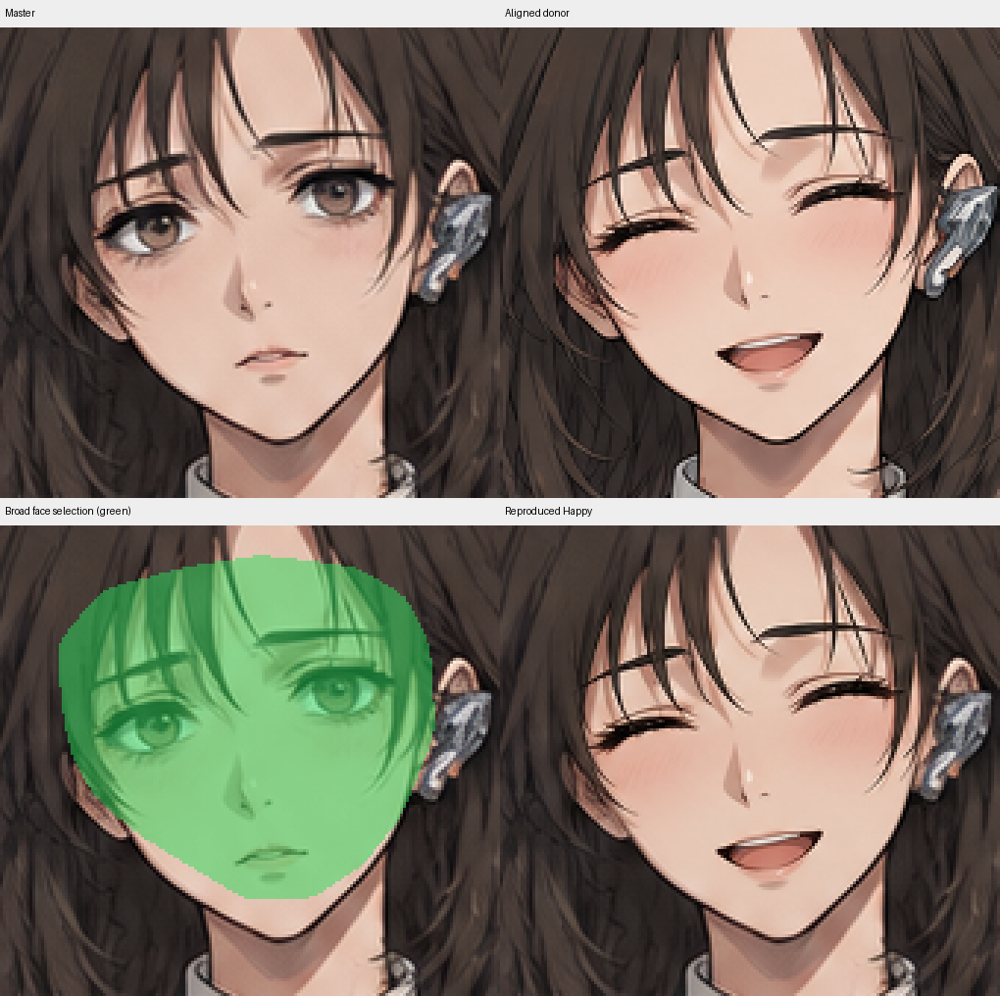
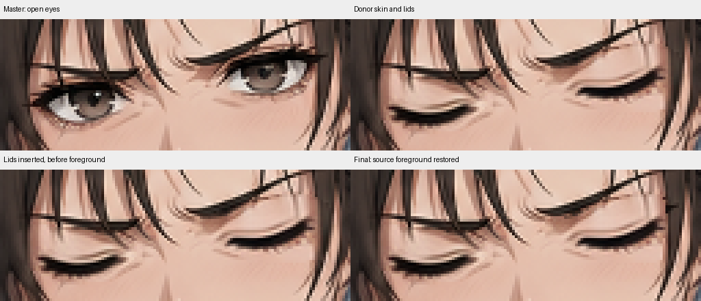
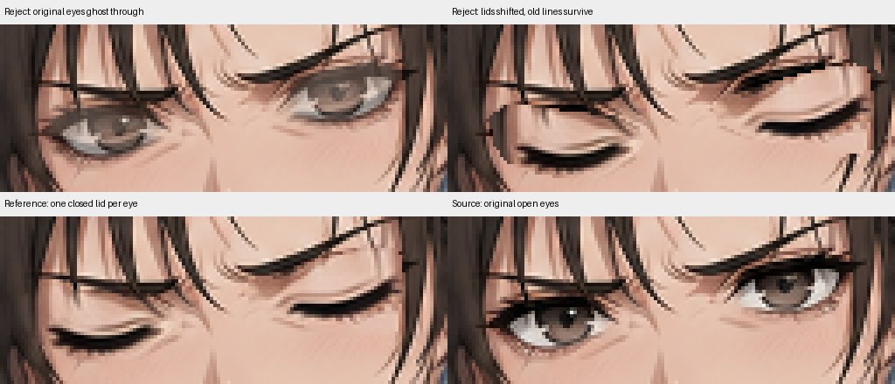

# VN artwork production manual

Create poses, expressions, and blink/talk animation while preserving character identity, source artwork outside the edit, and source transparency. This file defines the procedure, tools, examples, and acceptance criteria for new work.

## Start here

1. Read this manual before editing. Read the pose's input record to identify its exact master and existing approvals.
2. Inspect the source and selected donors. Choose the method in [section 3](#3-choose-the-transplant-method) from their actual geometry.
3. Before the first transplant in an artwork task, run `python experiments/workflow_examples.py` and inspect `static_stages.png`, `selection_roles.png`, `layered_stages.png`, and `reject_examples.png` under `experiments/.workflow_checks/examples/`. The complete examples are implemented in [workflow_examples.py](experiments/workflow_examples.py). They demonstrate broad registered replacement and layered eye replacement; neither supplies coordinates for a different pose.
4. Complete one expression and demonstrate one clean eye or mouth replacement before generating the remaining animation donors. Continue only when the relevant [visual criteria](#8-judge-the-final-images) pass.

Install `requirements.txt` into the Python environment used for the scripts. All commands run from the repository root. Keep candidates in an ignored experiment `output/` directory. Select donors by explicit paths; record the files actually loaded, without fallback searches.

### Required order and evidence

| Stage | Produce before advancing |
|---|---|
| Inspect master | Exact source path, dimensions, alpha, face crop, intended expression and state |
| Generate/select expression donor | Native-scale comparison establishing suitable expression, anatomy, line quality, and alignable geometry |
| Register donor | Marked corresponding anchors, transform, aligned overlay showing coherent placement |
| Transplant static expression | Selections, actual intermediate stages, final face with no surviving old features or unwanted donor content |
| Generate/select animation donors | Blink and speaking donors referenced to the finished static expression |
| Build four states | `idle`, `blink`, `talking`, `blink_talking`, preserving the expression's unaffected features |
| Review | Native-scale faces, enlarged individual regions, decoded GIF frames, six explicit visual verdicts |
| Publish | Passing review of the exact candidate and successful integrity verification |

Do not generate animation donors from an unfinished transplant. If the static expression fails, fix it before extending the state set. A complete collection of files does not establish a complete task.

## 1. Generate and select donors

### Specify emotion and state separately

Use readable anime-style expressions at the intended display size. A recognizable happy smile is sufficient; maximum intensity and dramatic changes to every feature are unnecessary. Stop increasing intensity once the intended emotion reads clearly.

| State | Visible requirement |
|---|---|
| Open eyes | Clearly open; an expression-specific squint may be used if it remains unambiguous |
| Closed eyes | Fully closed lids; no visible iris, sclera opening, or retained open-eye outline |
| Resting mouth | Closed or barely parted; Shocked may have a tiny opening, clearly smaller than speaking |
| Speaking mouth | Clearly visible opening, retaining the emotion and distinct from resting |
| Expression | Happy reads as happy; Shocked as surprised; Angry as angry; Neutral remains neutral |

`idle` and `blink` use the resting mouth. `talking` and `blink_talking` use the speaking mouth. Filenames do not establish the actual state.

Edit the actual master through the image tool's supported image-reference parameter. A pathname written inside a prompt is not a reference input. Inspect the available tool schema rather than inventing parameters. For example, when the built-in tool exposes `referenced_image_paths`, pass the absolute master path in that array. Set `transparent_background` when requesting transparency. The Python compositor preserves final alpha independently of the generated background.

Example donor prompts, with the appropriate image supplied as the reference:

- **Happy resting:** "Clearly happy anime expression, a readable closed-mouth smile with raised corners and cheerful open eyes. Preserve character identity, head angle, face proportions, and rendering style."
- **Shocked resting:** "Clearly surprised anime expression: raised brows, widened eyes, lips closed or only very slightly parted. Preserve head angle, facial proportions, identity, and rendering style."
- **Blink:** "Using this finished expression, fully close both eyes with natural expressive lids. Preserve brows, mouth, facial shading, and head angle. No visible iris or eye opening."
- **Talking:** "Using this finished expression, open the mouth visibly for speech, clearly distinct from the resting mouth. Preserve the emotion, brows, eyes, jaw, and head angle."

Use full-canvas donors with the master's framing by default. Crop their existing pixels for transplantation. Clothing, body, or background changes outside the intended transplant are irrelevant; those pixels must not enter the final composite.

A generated close-up is an alternative for a named deficiency such as insufficient feature detail or incompatible geometry in available donors. Record its source crop bounds and map it back to native scale. Generation can change stroke weight, shading, sharpness, and anatomy; resizing does not automatically restore compatibility. Cropping an existing donor does not redraw its pixels.

Compare source and donor at native face scale before selecting. Reject wrong states, malformed anatomy, incompatible head angle, or incompatible rendering **within the copied area**. Regenerate for the specific defect, not a vague desire for something stronger. Reuse donors that satisfy the task.

## 2. Coordinates, arrays, and tools

Use native-image coordinates for measurements. `x` increases rightward; `y` increases downward. Pillow crop boxes are `(x0, y0, x1, y1)` with the final edges excluded. NumPy indexing is `[y, x]`; array shape is `(height, width, channels)`; OpenCV output size is `(width, height)`.

```python
from pathlib import Path
import sys
sys.path.insert(0, str(Path("experiments").resolve()))
from artwork_tools import composite, align_feature, match_skin, compose_feature, save_stage_review
import cv2
import numpy as np
from PIL import Image, ImageDraw

source = np.asarray(Image.open("static/sprites/05_angry.png").convert("RGBA"))
h, w = source.shape[:2]

def selection(points):
    mask = Image.new("L", (w, h), 0)
    ImageDraw.Draw(mask).polygon(points, fill=255)
    return np.asarray(mask, dtype=np.float32) / 255.0
```

Pillow supplies RGB/RGBA arrays. OpenCV `imread` normally supplies BGR/BGRA; convert channel order before mixing them. Arithmetic on `uint8` can wrap: cast to float or signed integers before subtraction. Toolkit coverage arrays have shape `(h,w)` and values **0–1**, not 0–255. A mask loaded from a PNG requires conversion.

| Operation | API / input | Use and limitation |
|---|---|---|
| Crop without redraw | `Image.crop(box)` | Extract existing donor pixels; record the crop's origin |
| Move/rotate/scale | `align_feature(donor, selection, matrix, (w,h))` | Applies a supplied 2×3 donor-to-target mapping to pixels and coverage; does not find anatomy |
| Three-point affine | `cv2.getAffineTransform(D, S)` | Three non-collinear float32 point pairs; may introduce shear, so prefer a similarity transform unless justified |
| Blend | `composite(canvas, donor, coverage)` | Computes `(1-a)*canvas + a*donor`, preserving canvas alpha; cannot remove anatomy outside coverage or correct placement |
| Skin tone | `match_skin(source, donor, samples, skin, limit=12)` | Median RGB offset from corresponding skin samples; applies only inside `skin`, not linework |
| Layered edit | `compose_feature(...)` | Ordered background replacement, feature insertion, cleanup, source foreground restoration; caller supplies geometry and repair pixels |
| Small-area reconstruction | `cv2.inpaint(rgb, uint8_mask, radius, cv2.INPAINT_TELEA)` | Fills from surrounding pixels; may propagate nearby lashes/hair into skin |
| Gradient blending | `cv2.seamlessClone(src_bgr, dst_bgr, mask, center, cv2.NORMAL_CLONE)` | Optional tone/gradient treatment after alignment; alters colours, has no RGBA support, and does not infer anatomy |
| Inspect real stages | `save_stage_review(path, stages, box, scale=8)` | Fixed-coordinate nearest-neighbour crops of actual intermediate arrays |

Use nearest-neighbour enlargement for pixel diagnosis. Use appropriate resampling for an actual transform; avoid repeated resizing. `align_feature` premultiplies selection coverage before warping to avoid black crop-edge fringes. Never transform source-removal or source-foreground selections along with the donor.

## 3. Choose the transplant method

| Observed condition | Method | Evidence required |
|---|---|---|
| Static expression changes brows, eyes, mouth and supporting shading together; overall face geometry aligns | Broad coherent facial patch | Registration overlay; boundary on compatible skin; source foreground retained where needed |
| Blink/talk donor matches the finished expression's geometry | Separate eye/mouth replacement | Full old-feature footprint covered; desired new contour retained; unchanged surroundings |
| Feature displaced but shape and perspective compatible | Translate; add uniform scale/rotation only as measured | Marked correspondences, aligned overlay; expression proportions preserved |
| Shape differs locally despite suitable pose | Limited local reshape or contour reconstruction | Justified local displacement; continuous line thickness and anatomy |
| Head angle, jaw/nose relationship or line style cannot be reconciled without distorting identity | Select/regenerate a compatible donor | Name the mismatch within the copied region |

**Mask-only replacement assumes registration already holds.** Check it for every donor. Identical canvas dimensions, conditioning on the same reference, and sharp pixels do not establish registration. Reusing one insertion polygon across newly generated images does not align them.

### Establish alignment

Mark corresponding points on both native-scale images. Use stable head landmarks for a broad patch: nose bridge/tip, chin, ear attachment, and eye corners where identifiable. Do not force expressive eyebrows, eye aperture, or smile width back into the Neutral shape. For closed lids use corners and stable surroundings, never a nonexistent iris centre. Place a mouth relative to the nose, philtrum, and chin; its opening and width may intentionally change.

1. Fit a translation if all anchors have approximately the same displacement.
2. Use uniform scale/rotation if anchor distances/angles establish a size or roll difference.
3. Check a landmark not used to fit the transform. An exact fit to two points alone does not establish a correct face.
4. Display the aligned donor and source at 50% opacity, plus separate edge/anchor overlays. Double contours in intended stable boundaries mean registration is unfinished. Do not blend the final patch yet.
5. If one transform cannot align the relevant anatomy, use a local feature transform or reject the donor. Do not hide the mismatch by narrowing the insertion mask.

A concrete two-point mapping using the registered Angry donor crop: local lid points `(15,35)` and `(47,38)` map to target `(475,147)` and `(507,150)`. These numbers describe that crop, not a different pose.

```python
D = np.array([[15, 35], [47, 38]], dtype=np.float32)
S = np.array([[475, 147], [507, 150]], dtype=np.float32)
u, v = D[1]-D[0], S[1]-S[0]
a = float(np.dot(u, v) / np.dot(u, u))
b = float((u[0]*v[1] - u[1]*v[0]) / np.dot(u, u))
linear = np.array([[a, -b], [b, a]], dtype=np.float32)
matrix = np.column_stack([linear, S[0] - linear @ D[0]])
assert np.allclose(matrix, [[1, 0, 460], [0, 1, 112]])
crop = np.asarray(Image.open(
    "experiments/14_angry_animation/assets/eyes_closed_angry_patch.png").convert("RGBA"))
donor, support = align_feature(crop, np.ones(crop.shape[:2]), matrix, (w, h))
overlay = composite(source, donor, support * 0.5)  # Diagnostic only.
```

For cropped or enlarged donors, record both crop origin and scale. A generated crop point `(u,v)` mapped with uniform scale `s` to master crop origin `(x0,y0)` has `(x,y)=(x0+s*u,y0+s*v)` before further measured correction. Establish `s` from actual feature geometry, not merely requested dimensions.

### Broad static-expression example



Top: master and registered donor. Bottom: selection overlay and final expression. This historical Happy supplies closed eyes and an open smile; it illustrates static transplantation, not the required resting/open-eye state for a new animation.

The reproducible example uses panel `sheet[:561,350:700]`, this recorded transform, and a face selection extending beyond the replaced features:

```python
matrix = np.array([[.6674, -.02563, 418.8],
                   [.02563, .6674, -7.6]], np.float32)
face_points = np.array([(144,147),(184,139),(233,143),(260,158),(272,182),
    (276,225),(260,270),(242,294),(217,312),(184,314),(153,297),(128,283),
    (105,265),(92,244),(86,218),(83,187),(104,160)], np.int32)
```

[The complete runnable example](experiments/workflow_examples.py) builds the selection, transforms it and the portrait, samples corresponding neutral skin, matches the palette, and compares its output with the historical builder on the current runtime. The recorded matrix is specific to that sheet. Measure a new mapping for new donors. Historical PNGs can differ slightly with numeric library versions; the example reports that difference separately and does not overwrite them.

## 4. Separate removal, insertion, and foreground


Green covers the old open-eye footprint to replace. Orange covers donor lids. Blue and purple identify source hair and brows that belong in front. These regions are deliberately different.

| Selection | Coordinates | Include / exclude |
|---|---|---|
| Source removal | Master | Entire unwanted old feature, antialiasing, lashes/shadows that must vanish; may exceed new feature size |
| Donor insertion | Donor, then transformed | Desired new contour and necessary supporting pixels; exclude unwanted donor hair/jaw/background |
| Source foreground | Master | Traced source hair/brows that should remain in front; exclude obsolete eye/mouth strokes |
| Cleanup | Target | Specific remaining skin, join, or contour repair |

Trace outlines from enlarged images and display selections over the native image. Bounding rectangles locate a region; their contents are not automatically safe to paste. Trace donor insertion after registration. Include intended antialiasing and lash tips. Constrain colour thresholds inside traced anatomical regions: dark pixels may be lashes, brows, hair, or mouth.

Concrete left-eye selections used by the layered Angry example:

```python
removal = selection([(474,143),(478,140),(485,140),(493,141),(502,142),
    (510,143),(516,146),(517,151),(514,156),(507,160),(497,161),
    (487,159),(479,156),(475,151)])
insertion = selection([(475,147),(478,147),(484,149),(490,150),(497,150),
    (503,149),(507,150),(505,154),(500,156),(493,157),(486,156),
    (480,154),(476,151)])
hair = selection([(514,129),(519,131),(521,137),(524,143),(528,149),
    (533,157),(532,164),(527,158),(523,151),(519,145),(516,139)])
brow = selection([(476,135),(482,135),(489,136),(497,137),(505,138),
    (513,139),(519,141),(520,143),(515,142),(507,141),(498,140),
    (490,139),(482,138),(477,138)])
insertion *= 1 - hair
```

Do not shrink removal to the closed lid's footprint. If an old mouth lies at `x=566` and insertion begins at `x=574`, changing feather strength cannot erase it. Its full line and antialiasing need repair coverage independently of where the new mouth goes.

## 5. Replace and repair the pixels

### Obtain repair pixels

Choose the least destructive method that supplies the missing artwork:

| Situation | Operation | Reject the result if |
|---|---|---|
| Registered donor has appropriate skin around the new feature and covers the complete old one | Replace the broader old-feature region with donor skin, refine insertion, restore source foreground | Old feature survives, donor hair/contours enter skin, shading discontinuity appears |
| Nearby source skin has matching shading and no features | Translate a clean source patch into removal; match the local gradient | Repeated texture, a brightness shelf, or unrelated contour appears |
| Small missing patch on smooth skin | Fit a local colour plane from surrounding clean skin | Samples include linework; reconstruction crosses a contour or loses intended shading |
| Small isolated unwanted stroke with clean surroundings | Bounded inpainting | Hair/lashes spread into the fill, skin becomes muddy, or contours bend |
| Missing line endpoint | Reconstruct a short tapered stroke from its neighbours | Width, tangent, colour, or antialiasing changes abruptly |

Start with aligned donor skin when it already covers the complete old feature. The worked example below uses this method. Its replacement region includes donor lids as well as skin; separate blank-skin reconstruction is unnecessary because the replacement already removes the old eye.

For a small smooth-skin gap, a local plane can be fitted with `np.linalg.lstsq` to clean surrounding RGB samples using columns `[x, y, 1]`. Limit the prediction to the missing gap. Filling an entire eye region from a surrounding ring can produce a flat, visibly bounded patch: reject it. A plane cannot reconstruct a nose, crease, hair, or curved highlight. Show and inspect any reconstructed background before insertion.

For small bounded inpainting, use `cv2.inpaint(source[:,:,:3].copy(), mask_uint8, 3, cv2.INPAINT_TELEA)` where `mask_uint8` marks unwanted pixels as 255. Inspect the repaired region alone. Do not inpaint a whole face to solve a misplaced feature.

For a missing contour, sample neighbouring stroke colours and trace its tangent. Draw a short variable-width path on a layer at 4× native resolution, taper the endpoint, downsample once, then composite only that bounded repair. Compare the join at native and enlarged scale. Do not smooth surrounding linework to hide the gap.

### Match skin and composite

Sample corresponding clean skin after alignment, outside all feature strokes. Apply correction only to selected donor skin. If parts of the patch need opposite corrections, use local skin regions or shading correction; one RGB offset cannot match a different lighting gradient.

```python
# Continue with the registered donor and selections above.
def skin_pixels(image):
    r, g, b = [image[:,:,i].astype(np.int16) for i in range(3)]
    return ((r > 120) & (g > 70) & (b > 45) & (r-g > 12)
            & (g-b > 3) & (r-g < 100))

inside = removal > 0
outer = cv2.dilate(inside.astype(np.uint8), np.ones((9,9), np.uint8)) > 0
ring = outer & ~inside
samples = ring & skin_pixels(source) & skin_pixels(donor) & (support > .99)
# Inspect this ring on both images. These thresholds are specific to these assets.
corrected, offset = match_skin(source, donor, samples.astype(np.float32),
                               skin_pixels(donor).astype(np.float32), limit=8)
foreground = np.zeros((h,w), np.float32)
for traced, threshold in ((brow,225), (hair,230)):
    core = (traced > 0) & (source[:,:,:3].max(axis=2) < threshold)
    grown = cv2.dilate(core.astype(np.uint8), np.ones((3,3), np.uint8)) > 0
    boundary = cv2.dilate((traced > 0).astype(np.uint8), np.ones((3,3), np.uint8)) > 0
    foreground[grown & boundary] = 1
removal_edge = np.minimum(removal, cv2.GaussianBlur(removal, (3,3), .6))
insertion_edge = np.minimum(insertion, cv2.GaussianBlur(insertion, (3,3), .55))
final, allowed, stages = compose_feature(
    source, donor, insertion_edge,
    repair_image=corrected, removal=removal_edge, foreground=foreground,
)
save_stage_review("experiments/.workflow_checks/eye.png", stages, (468,125,535,166))
```

This code reproduces the established left-eye operations with the toolkit API and real source geometry: matched donor skin supplies the broad replacement; the original donor lid supplies the contour. It is not a new-pose template. Sampling and foreground boundaries need inspection for the target image. Save masks and overlays; never infer anatomy solely from colour thresholds.

### Feathering has a limited job

Use full replacement coverage over obsolete feature pixels. Keep the transition on compatible skin. A small antialiased edge can soften a skin join; broad Gaussian blur mixes the original feature back in. Clamping feather coverage inside the traced selection prevents unintended writes outside it:

```python
hard = (insertion > 0).astype(np.float32)
soft_edge = np.minimum(hard, cv2.GaussianBlur(hard, (3,3), .55))
```

Inspect the boundary. If an old stroke lies there, enlarge removal or supply clean repair pixels. Feathering cannot move a feature, repair anatomy, classify hair, or erase a stroke outside coverage.

### Layered example and operation order



The verified example replaces the old eye area with aligned donor skin and lids, refines lid coverage, then restores source hair/brows last. Its first replacement already includes the donor's closed lid; that intermediate is not blank skin. The final array matches published Angry `blink_talking.png` exactly.

For independent removal use: **align → reconstruct old-feature background → insert new feature → repair specific joins → restore intended source foreground**. Restoration must not restore an obsolete iris, lash, or mouth. Preserve the first eye's repaired result when repairing the second; do not restart each repair from the original.

## 6. Diagnose a failed result



Top left: old eyes remain visible through new lids. Top right: displaced lids and retained old contours. Bottom left: established closed-eye reference. Bottom right: original open eyes. Rejected panels are deliberately constructed defects, not acceptable alternative styles.

| Symptom | Establish cause at the first faulty stage | Correct operation |
|---|---|---|
| Mouth beside original mouth | Old mouth survives background stage; new mouth misplaced in aligned donor | Repair complete old mouth; align donor to nose/philtrum/chin before insertion |
| Iris/sclera visible during blink | Removal footprint or coverage misses old eye | Reconstruct complete region; retain one intended closed-lid contour |
| Hair wedge cuts into cheek | Donor hair/jaw inside insertion | Correct registration/selection; reconstruct skin; restore intended source foreground |
| Entire feature shifted | Alignment overlay fails | Correct donor transform using anchors; changing mask width does not move pixels |
| Face looks pasted together | Inconsistent head angle, feature scale, jaw relationship, or rendering | Reconsider coherent broad patch, per-feature mapping, or donor suitability before blending |
| Brow/old lash reappears after clean intermediate | Foreground copied obsolete line | Correct foreground selection; do not restore all dark pixels |
| Correct feature, visible patch boundary | Skin samples, gradient, or edge differs | Correct local skin/shading; place join on compatible skin without cutting features |
| Grey/doubled outline | Partial coverage mixes old/new strokes | Fully replace old line and retain new contour; reduce feathering across linework |
| Cut lash or detached fragment | Insertion/foreground clips donor stroke | Recover endpoint or reconstruct short tapered continuation |
| Correct PNG, flickering/washed-out GIF | Decoded frames differ from intended state/colours | Fix state mapping, palette, matte or encoding; inspect all decoded frames |

For each correction, mark a native-coordinate crop, name the first faulty stage, state the operation, and compare previous/new finals at identical coordinates. A pixel-difference count establishes whether an operation reached the region, not whether it improved the image.

```python
from artwork_tools import region_effect
print(region_effect(source, final, removal))
assert np.array_equal(source[:,:,3], final[:,:,3])
changed = np.any(source[:,:,:3] != final[:,:,:3], axis=2)
assert not np.any(changed & ~allowed)
```

Compare against the **previous final** as well as the master to assess a claimed correction. Zero changed pixels in the defect region means that correction did not reach it. Nonzero changes still require visual inspection. Review again after foreground restoration and encoding, which can cover or alter an earlier repair.

After two unsuccessful attempts on one defect, stop changing contours or blur values. Reopen source, aligned donor, masks, repair stage, and final. State which assumption failed: registration, source coverage, donor suitability, foreground classification, shading, or output identity. Change that part of the method and prove one correction before rebuilding the set. Retain the previous working result.

## 7. Build expression-specific animation

Use the **finished static expression** as every state's base. Blink preserves its mouth; talking preserves its eyes/brows; both preserve established expressive shading.

| Output | Eyes | Mouth |
|---|---|---|
| `idle.png` | Open | Resting |
| `blink.png` | Closed | Same resting mouth as idle |
| `talking.png` | Same open eyes as idle | Speaking |
| `blink_talking.png` | Same closed eyes as blink | Same speaking mouth as talking |

Reuse a source state that already matches. An open-mouth/closed-eye source may supply `blink_talking`; do not relabel it idle. Establish registration and selections for each new donor independently.

```python
# eye_edit(base) and mouth_edit(base) are the inspected pose-specific layered edits.
idle = finished_expression.copy()
blink = eye_edit(idle)
talking = mouth_edit(idle)
blink_talking = eye_edit(talking)
```

Apply operations to the supplied base rather than resetting to Neutral. For overlapping regions choose and inspect an explicit operation order; restoring an old base can undo a correct edit.

Use `finish_animation(folder, source_path, frames, regions, inputs=donor_paths, scripts=script_paths, reviews=review_files)` from [artwork_tools.py](experiments/artwork_tools.py) to save four states, standard `blink.gif`, `talk.gif`, `combined.gif`, and a final manifest. `frames` maps state names to RGBA arrays; `regions` maps them to independently declared allowed masks relative to `source_path`. Include intermediate panels and native faces in `review_files`. Record every donor, geometry/config file, and imported compositor used by the build in `inputs` or `scripts`.

The preview renderer uses a pale-grey opaque matte and shared GIF palette. Do not discard alpha with `.convert("RGB")` and assume the matte is correct. Final PNG alpha must match the intended pose source. Encode after all postprocessing; record final hashes after encoding.

Decode delivered animations, not just PNG inputs:

```python
folder = Path("experiments/your_experiment/output")
for name in ("blink.gif", "talk.gif", "combined.gif"):
    with Image.open(folder / name) as gif:
        for index in range(gif.n_frames):
            gif.seek(index)
            face = gif.convert("RGB").crop(face_box)
            face.resize((face.width*4, face.height*4), Image.Resampling.NEAREST).save(
                folder / f"{name}.{index}.review.png")
```

Define `face_box` for the pose. Include decoded review panels before recording the build, or rebuild the manifest after adding them. Inspect temporal transitions as well as individual frames.

## 8. Judge the final images

Review selected artifacts at native face size, intended display size, and enlarged individual regions. Full-body previews can hide small defects. Wide montages can be downscaled: open eyes and mouth as separate crops too.

For each criterion record **pass**, **fail**, or **uncertain**, a concrete observation, and recorded image filenames showing what was inspected. Recognizable emotion is only one criterion. These defects reject an image even when its emotion reads clearly:

| Criterion key | Pass evidence | Reject / uncertain condition |
|---|---|---|
| `geometry` | Features belong to one head perspective/scale; placement agrees with nose/chin and intended expression | Mouth on cheek, mismatched eye angle/size, disconnected anatomy; correspondence not established |
| `source_removal` | One intended mouth; no obsolete iris/lash/open-eye remnants in blink; old footprint clean | Second mouth line, ghost iris, doubled contour, uninspected old-feature boundary |
| `foreground` | Intended source hair/brows and crossings retained; no unwanted donor content | Hair wedge in cheek, clipped strand, displaced brow, obsolete lash restored |
| `joins` | Continuous contours, compatible skin shading/stroke weight at native and enlarged scale | Visible patch, dark fringe, blurred/doubled line, clipped endpoint |
| `expression_states` | Emotion readable in all states; eyes and mouths match the state table | Wrong/ambiguous state, lost expression, swapped state |
| `animation` | All decoded frames match intended states; only intended features move; matte/palette stable | Face/hair jumps, skin flashes, colour changes, incorrect sequence |

If a region cannot be assessed confidently, record `uncertain` and obtain a clearer crop or further review. Do not turn uncertainty into a pass to finish. An inspection note, changed-pixel count, successful decoding, or integrity pass does not certify visual quality.

## 9. Record review and publish

Build into the candidate directory; record actual input/script/output identities in `build.json`. Never publish as a build side effect. An unchanged build can retain its review; changed artifacts require new review.

```sh
python experiments/verify_remaining_animations.py experiments/your_experiment/output --check-inputs
python experiments/publish_artwork.py experiments/your_experiment/output --review-template experiments/your_experiment/output/visual_review.json
```

The template is bound to this artifact set. Inspect the candidate, fill all six findings, then record it:

```sh
python experiments/publish_artwork.py experiments/your_experiment/output --reviewed-by codex --review-file experiments/your_experiment/output/visual_review.json
python experiments/publish_artwork.py experiments/your_experiment/output --destination static/animation/your_set
```

One completed criterion has this shape; the generated form supplies all six:

```json
"source_removal": {
  "status": "pass",
  "observation": "Both closed-eye crops show one lid each with no surviving iris, sclera opening, or old upper-lash fragments; the resting mouth has one contour.",
  "evidence": ["eye_stage_review.png", "four_states_face_comparison.png"]
}
```

Use actual observations and actual filenames already recorded by the build. Do not copy this example as an assessment. Failed/uncertain reviews are recordable but block publication. A historical `reviewed` note alone is insufficient for new publication. The publisher checks structure and artifact identity; it cannot determine whether an observation is truthful or visually correct.

User approval is separate: record an actual user statement with `--approval-note`, or rejection with `--not-approved-note`. Do not infer approval from agent review or integrity. Existing publication authorization remains valid; no additional permission is required merely because publication is a separate command.

Integrity covers dimensions, decoding, source identity, original alpha, hashes and containment within declared regions. Declare those regions from intended operations, never from the resulting diff. Integrity cannot detect duplicated anatomy inside an allowed region.

Keep masters, selected donors, builders, exact input records, and selected published assets. Keep alternatives and diagnostics under ignored output. Record local status concisely: master, inputs, current build, unresolved defects, review, user approval, next action.

## Assets and implementation scope

- [Published asset index](static/animation/README.md); [reading-pose input record](static/poses/document_reading/README.md).
- [artwork_tools.py](experiments/artwork_tools.py): current compositing and record API; [workflow_examples.py](experiments/workflow_examples.py): complete runnable examples for this manual.
- [Historical static compositor](static/vn_expression_transplant.py): fixed sheet registration and historical arithmetic. Its geometry is not a new-pose template.
- [Angry compositor](experiments/14_angry_animation/angry_visual_blink.py): established layered reference for its registered crop.
- [animation_builder.py](experiments/animation_builder.py): established builders use a compatibility path for registered crops; new pipelines require explicit alignment and layers. Its initial mask/blend helpers alone are not a transplant procedure.
- Experiment READMEs describe local inputs and commands, not alternative production rules. Older methods and chronology are in [HISTORY.md](HISTORY.md).

### Verify the workflow implementation

```sh
python experiments/workflow_examples.py
python -m unittest discover -s experiments/tests -v
python experiments/verify_remaining_animations.py
```

The example runner checks reproduction; tests exercise compositing, stale builds, review evidence and publication rejection. These are implementation checks. Before trusting a revised procedure for a full set, demonstrate one clean transplant with a new donor and apply the six visual criteria.
